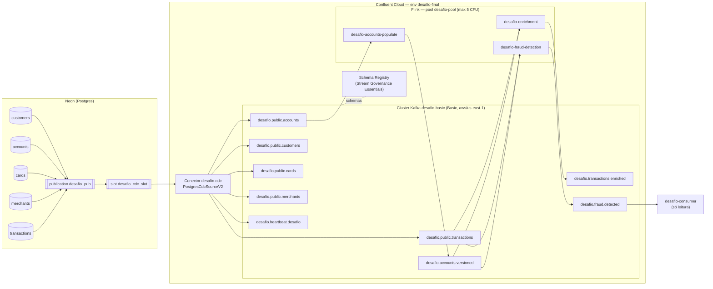

# Documentação técnica do projeto — Pipeline de pagamentos

Guia de estudo: **o que existe, como se chama, quem fala com quem e por quê**.
Tudo aqui foi lido do código do repositório ou conferido na nuvem em **2026-11-23** (comandos `confluent`, `SHOW CREATE TABLE` e `describe`). Quando algo é inferência e não medição, está marcado como **[hipótese]**. O `README.md` continua sendo o entregável; este arquivo é material de apoio.

Segredos (senhas, API secrets, host do banco) **não** aparecem aqui e nunca devem aparecer.

---

## 1. O que o projeto faz, em uma frase

Lê transações de pagamento de um Postgres (Neon) **em tempo real** via CDC, publica em tópicos Kafka com schema Avro, enriquece cada transação com dados da conta (Flink SQL) e dispara um **alerta de fraude** quando um cartão faz **3 ou mais transações em até 60 s**. Um consumidor com permissão só de leitura lê os alertas.

## 2. Mapa geral



Leitura do desenho:
- **Linha do dado:** Postgres → conector → `desafio.public.*` → Flink → `enriched` e `fraud.detected`.
- **`desafio.accounts.versioned`** é uma tabela *intermediária* criada para o temporal join (veja seção 8).
- **`desafio.transactions.enriched` não tem consumidor.** É saída analítica; ninguém no projeto lê esse tópico (medido por busca nos scripts).
- A regra de fraude lê `desafio.public.transactions` direto, **não** o `enriched`.

---

## 3. Inventário de nomes (tudo que existe)

Os nomes vêm do `.env` (que não é versionado; o `.env.example` mostra as chaves). Valores medidos:

| Item | Nome | Origem |
|---|---|---|
| Prefixo de recursos | `desafio-` | `RESOURCE_PREFIX` |
| Prefixo de tópicos/subjects | `desafio` | `TOPIC_PREFIX` |
| Environment | `desafio-final` | `ENV_NAME` |
| Cluster Kafka | `desafio-basic` (Basic, single-zone, aws `us-east-1`) | `CLUSTER_NAME`, `CLUSTER_CLOUD`, `CLUSTER_REGION` |
| Schema Registry | pacote **Essentials**, criado junto com o environment | `01-foundation.sh` |
| Service account de escrita | `desafio-producer` | `PRODUCER_SA_NAME` |
| Service account de leitura | `desafio-consumer` | `CONSUMER_SA_NAME` |
| Prefixo de consumer groups | `desafio-` | `CONSUMER_GROUP_PREFIX` |
| Compute pool Flink | `desafio-pool` (max 5 CFU) | `FLINK_COMPUTE_POOL_NAME` |
| Conector | `desafio-cdc` | `CONNECTOR_NAME` |
| Banco | `neondb`, porta 5432, SSL `require` | `PG_DATABASE`, `PG_PORT`, `PG_SSLMODE` |
| Usuário admin do banco | `neondb_owner` | `PG_ADMIN_USER` |
| Usuário do CDC | `cdc_user` | `CDC_USER` |
| Seed dos dados | `42` | `SEED` |
| Slot de replicação | `desafio_cdc_slot` | fixo em `connectors/cdc.json` |
| Publication | `desafio_pub` | fixo em `db/01-schema.sql` e `connectors/cdc.json` |

> Os **IDs** (`env-…`, `lkc-…`, `lfcp-…`, `lcc-…`, `sa-…`) mudam a cada ciclo de teardown/setup e ficam em `.state`. Para ver os atuais: `./scripts/status.sh`.

---

## 4. Origem: Postgres (Neon)

Arquivos: `db/01-schema.sql`, `db/02-cdc-user.sql`, `db/03-verify.sql`, `db/seed.py`, `db/apply.sh`.

### 4.1 Tabelas (dados 100% sintéticos)

| Tabela | PK | Colunas principais | Linhas |
|---|---|---|---|
| `customers` | `customer_id` | `full_name`, `email`, `phone`, `birth_date` (**PII**), `city`, `created_at` | 200 |
| `accounts` | `account_id` | `customer_id` (FK), `account_type` (CHECKING/SAVINGS/CREDIT), `status`, `risk_tier` (LOW/MEDIUM/HIGH), `balance`, `currency`, `opened_at`, `updated_at` | 240 |
| `cards` | `card_id` | `account_id` (FK), `card_number_mask` (**PCI**, só máscara + últimos 4), `brand`, `status`, `expires_on`, `issued_at` | 320 |
| `merchants` | `merchant_id` | `name`, `mcc`, `category`, `city`, `country` | 60 |
| `transactions` | `transaction_id` | `card_id`, `account_id`, `merchant_id` (FKs), `amount`, `currency`, `status` (APPROVED/DECLINED), `txn_ts` | 2000 |

Relações: `transactions → cards → accounts → customers` e `transactions → merchants`.

### 4.2 Pontos de configuração que o CDC exige

- `wal_level = logical` (checado pelo `apply.sh`).
- `REPLICA IDENTITY FULL` nas 5 tabelas: o evento de UPDATE e DELETE traz `before` e `after` completos.
- Publication `desafio_pub` criada **à mão** no SQL (o conector roda com menor privilégio e `publication.autocreate.mode=disabled`).
- Conexão **direta**, sem `-pooler` (o `apply.sh` recusa host com `-pooler`).
- `cdc_user`: `LOGIN`, `REPLICATION`, `USAGE` no schema e `SELECT` nas 5 tabelas. Sem INSERT/UPDATE/DELETE, DDL ou CREATEROLE.

### 4.3 O seed (`db/seed.py`)

Determinístico (`SEED=42` → saída idêntica byte a byte). Janela de tempo fixa: **2026-10-01 + 30 dias**.

Cenários de fraude embutidos, para a regra ser demonstrável:
- **6 cartões "rajada"** (3 a 5 transações em ≤ 40 s) → devem gerar alerta.
- **1 cartão "quase"**: 2 transações em 30 s → **não** alerta (só 2).
- **1 cartão "lento"**: 3 transações com 45 s de intervalo → **não** alerta (3ª cai em 90 s).
- Cartões normais: nunca têm duas transações a menos de 5 min uma da outra.

`transaction_id` é atribuído após ordenar por `(txn_ts, card_id)`, então os IDs seguem a ordem cronológica **no Postgres**.

---

## 5. Ingestão: conector CDC

Arquivo: `connectors/cdc.json` (template com `${VARIÁVEIS}`), criado por `scripts/04-connector.sh`.

| Propriedade | Valor | Significado |
|---|---|---|
| `connector.class` | `PostgresCdcSourceV2` | Conector gerenciado Debezium da Confluent |
| `table.include.list` | `public.customers, accounts, cards, merchants, transactions` | Tabelas capturadas |
| `topic.prefix` | `desafio` | Tópico = `desafio.public.<tabela>` |
| `output.data.format` / `output.key.format` | `AVRO` / `AVRO` | Valor e chave em Avro |
| `plugin.name` | `pgoutput` | Decodificação nativa do Postgres |
| `slot.name` | `desafio_cdc_slot` | Slot de replicação lógica |
| `publication.name` | `desafio_pub`, `autocreate=disabled` | Publication pré-criada |
| `snapshot.mode` | `when_needed` | Faz snapshot na 1ª vez e se o slot sumir |
| `heartbeat.interval.ms` | `60000` | Heartbeat a cada 60 s (tópico `desafio.heartbeat.desafio`) |
| `decimal.handling.mode` | `precise` | DECIMAL fica exato (bytes + logicalType decimal) |
| `after.state.only` | `false` | Envelope **completo** (`before`, `after`, `op`, `source`) |
| `tombstones.on.delete` | `true` | DELETE gera também um tombstone (valor nulo) |
| `tasks.max` | `1` | Uma task |
| `kafka.auth.mode` | `KAFKA_API_KEY` | Usa a API key Kafka da `desafio-producer` |

Operações do envelope: `c` (insert / snapshot), `u` (update), `d` (delete). Exemplos reais em `evidencias/01-envelopes-cdc.json`.

Consequência importante: como o envelope vem completo e a coluna `txn_ts` chega como **string** (não como timestamp), o Flink precisa de uma coluna calculada (seção 8).

---

## 6. Kafka: tópicos

Medido em 2026-11-23:

| Tópico | Partições | Quem escreve | Quem lê | Conteúdo |
|---|---|---|---|---|
| `desafio.public.customers` | 1 | conector | — | CDC de `customers` |
| `desafio.public.accounts` | 1 | conector | `desafio-accounts-populate` | CDC de `accounts` |
| `desafio.public.cards` | 1 | conector | — | CDC de `cards` |
| `desafio.public.merchants` | 1 | conector | — | CDC de `merchants` |
| `desafio.public.transactions` | 1 | conector | `desafio-enrichment`, `desafio-fraud-detection` | CDC de `transactions` |
| `desafio.heartbeat.desafio` | 1 | conector | — | Heartbeat do Debezium |
| `desafio.accounts.versioned` | **6** | `desafio-accounts-populate` | `desafio-enrichment`, `desafio-fraud-detection` | Contas "versionadas" (upsert, compactado) |
| `desafio.transactions.enriched` | 1 | `desafio-enrichment` | **ninguém** | Transação + dados da conta |
| `desafio.fraud.detected` | 1 | `desafio-fraud-detection` | `desafio-consumer` | Alertas de fraude |

- **Chave** dos tópicos CDC = PK da tabela (`transaction_id`, `account_id`, …), em Avro.
- `enriched` e `fraud.detected` têm **chave nula** (`key.format=raw`, coluna `key` VARBINARY).
- Fator de replicação 3 nos tópicos do CDC (registrado no README).
- **Ordem de gravação:** o `enriched` grava fora da ordem de `txn_ts` (1986 de 2000 linhas atrasadas > 5 s; `evidencias/07-ordem-enriched.txt`). Por isso o `enriched` serve como saída analítica, não como entrada de regras por tempo de evento.

---

## 7. Schemas (Schema Registry)

### 7.1 Dois conjuntos de subjects, com papéis diferentes

Medido: o Schema Registry hoje tem **21 subjects**.

**A) Gerados pelo conector (automáticos)** — `<tópico>-key` e `<tópico>-value`:
`desafio.public.{customers,accounts,cards,merchants,transactions}-{key,value}` e `desafio.heartbeat.desafio-{key,value}`. São o **envelope Debezium**, com nomes `desafio.public.*`.

**B) Contrato canônico, registrado por `scripts/03-schemas.sh`** — namespace `com.bootcamp.payments.*`, a partir de `schemas/*.avsc`:

| Subject | Arquivo | Namespace.Record |
|---|---|---|
| `desafio.customers-value` | `customers.avsc` | `com.bootcamp.payments.customer.Customer` |
| `desafio.accounts-value` | `accounts.avsc` | `…account.Account` |
| `desafio.cards-value` | `cards.avsc` | `…card.Card` |
| `desafio.merchants-value` | `merchants.avsc` | `…merchant.Merchant` |
| `desafio.transactions-value` | `transactions.avsc` | `…transaction.Transaction` |
| `desafio.fraud.detected-value` | `fraud-detected.avsc` | `…fraud.FraudAlert` |

Fato medido que costuma confundir: **não existem tópicos** `desafio.customers`, `desafio.accounts`, `desafio.cards`, `desafio.merchants` nem `desafio.transactions`. Esses subjects canônicos são o **contrato de domínio** (limpo, sem envelope CDC) e é onde ficam as **tags**; eles **não** estão ligados a nenhum tópico. **[hipótese]** a intenção é documentar o modelo de domínio e a governança; o dado real trafega pelos subjects do grupo A.

**C) Subjects de saída do Flink** — `desafio.transactions.enriched-value` (de `transactions-enriched.avsc`) e `desafio.fraud.detected-value` (de `fraud-detected.avsc`). Esses **são** usados: o `05-flink.sh` registra o schema **antes** de criar o tópico, e o Flink cria a tabela a partir dele (daí os `COMMENT` por coluna nas tabelas). O subject `desafio.fraud.detected-value` aparece em `03-schemas.sh` e `05-flink.sh`: é o mesmo nome, e vale o que foi registrado primeiro.

**D) `desafio.accounts.versioned-{key,value}`** — criados pelo Flink ao executar o `CREATE TABLE`.

Arquivo `schemas/transactions-raw.avsc` (namespace `org.apache.flink.avro.generated.record`): está versionado como referência de formato, mas **nenhum script o usa** (busca em todo o repositório).

### 7.2 Tipos

- Dinheiro: `bytes` + `logicalType: decimal(15,2)` (sem erro de float).
- Tempo: `long` + `timestamp-millis`.
- `birth_date` e `expires_on` são `string` no contrato canônico.

### 7.3 Governança

- Tags no catálogo: **`PII`** e **`PCI`** (medido: ambas existem).
- `PII`: `customers.full_name`, `email`, `phone`, `birth_date`. `PCI`: `cards.card_number_mask`.
- As tags são declaradas no `.avsc` (`"confluent:tags"`).
- Compatibilidade global: **BACKWARD**.
- Teste de evolução (`scripts/test-compat.sh`, `schemas/test-evolution/`; evidência da execução de 17/11 em `evidencias/03-contrato-de-dados.txt`):
  - `v2-compatible` (campo novo **com default**) → compatível.
  - `v2-add-required` (campo novo **sem default**) → rejeitado em BACKWARD.
  - `v2-incompatible` (remove `amount`) → rejeitado em FULL.

---

## 8. Processamento: Flink SQL

Arquivos: `scripts/05-flink.sh`, `sql/01-enrichment.sql`, `sql/02-fraud-detection.sql`.

### 8.1 Tabelas Flink (todas medidas com `SHOW CREATE TABLE`)

| Tabela | Tipo | Detalhes |
|---|---|---|
| `desafio.public.transactions` | criada pelo CDC | Vira `changelog.mode='append'` (via `ALTER`). Coluna calculada `txn_time` = `txn_ts` (string) convertida para `TIMESTAMP_LTZ`. `WATERMARK FOR txn_time AS txn_time - 5 s`. 1 bucket, formato `avro-debezium-registry` |
| `desafio.accounts.versioned` | criada por DDL | PK `account_id`, `changelog.mode='upsert'`, tópico **compactado**, **6 buckets**, `WATERMARK FOR updated_at AS updated_at - 5 s` |
| `desafio.transactions.enriched` | criada a partir do schema Avro | `append`, 1 bucket, `WATERMARK FOR txn_ts - 5 s` (ajustado por `ALTER`) |
| `desafio.fraud.detected` | criada a partir do schema Avro | `append`, 1 bucket |

### 8.2 Os 3 statements em execução (streaming, nunca terminam)

Todos: pool `desafio-pool`, `sql.tables.scan.idle-timeout=5s`.

| Statement | O que faz | Lê | Escreve |
|---|---|---|---|
| `desafio-accounts-populate` | Converte `updated_at` (string) para timestamp e grava as contas na tabela versionada | `desafio.public.accounts` | `desafio.accounts.versioned` |
| `desafio-enrichment` | **Temporal join** da transação com a conta **no instante da transação** (`FOR SYSTEM_TIME AS OF t.txn_time`) | `desafio.public.transactions`, `desafio.accounts.versioned` | `desafio.transactions.enriched` |
| `desafio-fraud-detection` | `MATCH_RECOGNIZE` por cartão; depois temporal join com a conta para obter `customer_id` | `desafio.public.transactions`, `desafio.accounts.versioned` | `desafio.fraud.detected` |

### 8.3 Regra de fraude (`RULE_VELOCITY_60S`)

```
PARTITION BY card_id  ORDER BY txn_time
PATTERN (T{3,}?)  WITHIN INTERVAL '60' SECOND
AFTER MATCH SKIP PAST LAST ROW
```
- Dispara com **3 transações** do mesmo cartão em até 60 s.
- `txn_count` sai **sempre 3** neste padrão (guloso-mínimo `T{3,}?` + `SKIP PAST LAST ROW`). Uma rajada de 5 gera um alerta de 3 e as 2 restantes não fecham novo padrão.
- Campos do alerta: `card_id`, `account_id`, `customer_id`, `first_transaction_id`, `last_transaction_id`, `txn_count`, `total_amount`, `window_start`, `window_end`, `rule_name`, `alert_ts`.
- **Decisão de projeto:** o `MATCH_RECOGNIZE` roda **antes** do join. Rodá-lo sobre o `enriched` perdia alertas (watermark atrás por causa da gravação fora de ordem).

### 8.4 Ordem de subida (importa)

1. Compute pool → 2. DDL `accounts.versioned` (só `COMPLETED` conta; checa se a tabela aparece no catálogo) → 3. `ALTER` de `transactions` (append, `txn_time`, watermark) e do `enriched` → 4. `desafio-accounts-populate` → 5. **`wait_accounts_versioned`**: espera 240/240 contas distintas → 6. `desafio-enrichment` → 7. `desafio-fraud-detection`.

O passo 5 é uma decisão de projeto: todas as contas têm a mesma data de atualização, então o join só avança pelo `idle-timeout`. Sem a espera pelas 240 contas, transações de contas ainda não carregadas seriam descartadas.

### 8.5 Resultado medido (setup final de 2026-11-23)

- `enriched`: **2000 linhas / 2000 transações distintas / 240 contas**.
- `fraud.detected`: **6 alertas** — cartões **100, 114, 228, 245, 260, 320**; **nenhum** para 126 ("quase") e 86 ("lento").

### 8.6 Melhoria para produção: service account dedicada para os statements

**Medido:** os 3 statements rodam com `principal` = meu usuário (usuário humano, não uma service account), porque o `05-flink.sh` não passa `--service-account`. Consequências:
- As ACLs do `desafio-producer` não cobrem a escrita do Flink; quem escreve em `enriched`, `fraud.detected` e `accounts.versioned` é o usuário.
- A descrição da SA no `01-foundation.sh` ("CDC e Flink") vale só para o CDC.

**Melhoria para produção:** rodar os statements com uma service account dedicada, com ACLs apenas nos tópicos que o Flink lê e escreve.

---

## 9. Identidades e permissões

### 9.1 Quem é quem

| Identidade | Tipo | Para que serve |
|---|---|---|
| `desafio-producer` | service account | Dona do conector; registra schemas e tags |
| `desafio-consumer` | service account | Lê alertas; **não escreve** |
| meu usuário | usuário humano | Cria/roda os statements Flink; CLI |

### 9.2 ACLs Kafka (medidas)

| Principal | Permissão | Recurso |
|---|---|---|
| `desafio-producer` | CREATE, WRITE, DESCRIBE | tópicos com prefixo `desafio` |
| `desafio-producer` | CREATE, WRITE, DESCRIBE | tópicos com prefixo `__debezium-heartbeat` |
| `desafio-producer` | DESCRIBE, DESCRIBE_CONFIGS | o cluster (exigido pelo Debezium V2) |
| `desafio-consumer` | READ, DESCRIBE | tópicos com prefixo `desafio` |
| `desafio-consumer` | READ | consumer groups com prefixo `desafio-` |

### 9.3 RBAC no Schema Registry (medido)

| Principal | Papel | Escopo |
|---|---|---|
| `desafio-producer` | `DeveloperWrite`, `DeveloperRead` | subjects `Subject:desafio*` |
| `desafio-producer` | `DataSteward` | environment (necessário para criar tags no catálogo) |
| `desafio-consumer` | `DeveloperRead` | subjects `Subject:desafio*` |

### 9.4 API keys (uma por SA **e por recurso**; o secret só aparece na criação)

| Variável no `.state` | Dono | Recurso |
|---|---|---|
| `PRODUCER_KAFKA_KEY/SECRET` | `desafio-producer` | cluster Kafka |
| `PRODUCER_SR_KEY/SECRET` | `desafio-producer` | Schema Registry |
| `CONSUMER_KAFKA_KEY/SECRET` | `desafio-consumer` | cluster Kafka |
| `CONSUMER_SR_KEY/SECRET` | `desafio-consumer` | Schema Registry |

O `metrics.sh` cria uma "Temp Metrics Key" (escopo `cloud`) só para consultar a Telemetry API e a apaga ao final.

### 9.5 Prova de menor privilégio

`scripts/06-consume.sh`: o `desafio-consumer` **lê** `desafio.fraud.detected` e, ao tentar **escrever**, recebe `Topic authorization failed`. Só essa mensagem aprova o teste.

---

## 10. Produtores e consumidores — quem fala com quem

| Papel | Quem | Credencial | Em quê |
|---|---|---|---|
| **Producer** do CDC | conector `desafio-cdc` | API key Kafka do `desafio-producer` | `desafio.public.*`, heartbeat |
| **Producer** do Flink | os 3 statements | usuário humano (ver 8.6) | `accounts.versioned`, `enriched`, `fraud.detected` |
| **Leitor** Flink | os 3 statements | usuário humano | `desafio.public.*`, `accounts.versioned` |
| **Consumer** dos alertas | `scripts/06-consume.sh`, `scripts/consume-alerts.sh` | `desafio-consumer` (Kafka + SR) | `desafio.fraud.detected` |
| **Consumer** de evidência | `scripts/evidence-cdc.sh`, `scripts/evidence-flink.sh` | `desafio-consumer` | `desafio.public.*`, `desafio.fraud.detected` |
| Consumer do `enriched` | **nenhum** | — | — |

Consumer groups usados pelos scripts (todos casam com o ACL `desafio-*`): `desafio-evidence-<epoch>`, `desafio-cdc-evidence-<epoch>`, `desafio-fraud-evidence-<epoch>`.

**Semântica de entrega** (do `07-operation.sh`): Postgres→Debezium *at-least-once* (LSN do slot); Debezium→Kafka *at-least-once*; Kafka→Flink→Kafka *exactly-once* (checkpoints + transações); tópico→consumidor *at-least-once*. Elo fraco: efeito colateral do consumidor (bloquear cartão, notificar) — mitigar com idempotência pela chave `(card_id, first_transaction_id, window_start)`.

---

## 11. Scripts: o que cada um faz

### 11.1 Fluxo principal

`./setup.sh` roda, em ordem: verifica o banco (carrega o seed só se `transactions ≠ 2000`) → cada `scripts/NN-*.sh` executável → `scripts/status.sh`.

| Script | Camada | O que cria / faz |
|---|---|---|
| `scripts/lib.sh` | — | Funções comuns: `load_env`, `state_set/state_load`, `retry`, `log`, `die`, `pg_admin_env`. Liga `set -euo pipefail` |
| `db/apply.sh` | 0 | Schema + `cdc_user` + seed + verificação no Neon |
| `scripts/01-foundation.sh` | 1 | Environment, cluster Basic, Schema Registry, 2 service accounts, ACLs, role bindings, 4 API keys |
| `scripts/03-schemas.sh` | 2 | `DataSteward`, tags `PII`/`PCI`, registro dos 6 schemas canônicos |
| `scripts/04-connector.sh` | 3 | Cria o conector, espera `RUNNING`, recria até 3× se falhar na criação |
| `scripts/05-flink.sh` | 4 | Pool, tópicos/subjects de saída, DDLs, os 3 statements e a espera das contas |
| `scripts/06-consume.sh` | 5 | Consumo com `desafio-consumer` + teste negativo de escrita → `evidencias/05-consumo.txt` |
| `scripts/07-operation.sh` | 5 | Métricas, ACLs, RBAC, custo e confiabilidade → `evidencias/06-operacao.txt` |

Não existe `02-*.sh`: a camada 2 (schemas) roda como `03-schemas.sh`.

### 11.2 Utilitários

| Script | Uso |
|---|---|
| `scripts/status.sh` | Estado real da nuvem e do Neon (somente leitura) |
| `scripts/cost.sh [início] [fim]` | `confluent billing cost list` |
| `scripts/metrics.sh` | Telemetry API (bytes recebidos/enviados/retidos) e lag |
| `scripts/consume-alerts.sh` | Lê os alertas como `desafio-consumer` |
| `scripts/test-compat.sh` | Demonstra compatibilidade BACKWARD/FULL |
| `scripts/evidence-{foundation,schemas,cdc,flink}.sh` | Geram os arquivos de `evidencias/` |
| `teardown.sh [--dry-run\|--yes\|--keep-neon]` | Derruba tudo, **só** com os nomes do `.env` |

### 11.3 Arquivos de estado e segredos

- `.env` — credenciais e nomes (**não versionado**). Modelo: `.env.example`.
- `.env.local` — conexão Neon (**não versionado**).
- `.state` — IDs e API keys gerados pelo setup, `chmod 600` (**não versionado**).
- `evidencias/` — saídas reais de comandos (versionadas, sem segredos; os scripts checam vazamento antes de salvar).
- `.bob/tmp/` — rascunhos locais, no `.gitignore`.

---

## 12. Evidências (`evidencias/`)

| Arquivo | Prova |
|---|---|
| `00-seed-e-banco.txt` | Seed e estado do Postgres |
| `01-envelopes-cdc.json` | Envelopes `c`, `u`, `d` e tombstone |
| `02-fundacao.txt` | Identidades, ACLs, menor privilégio |
| `03-contrato-de-dados.txt` | Schemas, tags, compatibilidade (execução de 17/11, commit `d205f51`) |
| `04-alerta-fraude.txt` | Flink e alertas |
| `05-consumo.txt` | Consumo autorizado + escrita negada |
| `06-operacao.txt` | Os 4 pilares (observabilidade, segurança, custo, confiabilidade) |
| `07-ordem-enriched.txt` | Medição da ordem de gravação do `enriched` |

---

## 13. Custo e operação

- **Custo de um dia com o pipeline ligado: US$ 30,37** (billing de 22/11, `./scripts/cost.sh 2026-11-22 2026-11-23`), coberto pelo crédito de teste; líquido US$ 0,00. Cluster Basic + Flink + conector cobram por hora. Saída em `evidencias/08-teardown-e-custo.txt`.
- **Sempre** ao terminar: `./teardown.sh --dry-run` e depois `./teardown.sh`. O Neon e os dados **não** são apagados; o slot `desafio_cdc_slot` é removido (slot órfão retém WAL).
- Retomar: `./setup.sh` (idempotente).
- Cuidado: `.state` some no teardown, e as API keys morrem junto.
- `idle-timeout=0` deixa o `enriched` vazio; manter `5s`.
- Não re-rodar `desafio-fraud-detection` sobre o mesmo tópico: duplica alertas em `desafio.fraud.detected`.

---

## 14. Glossário rápido

- **CDC** — Change Data Capture: captura as mudanças do Postgres lendo o log de replicação (WAL).
- **Slot / Publication** — mecanismos do Postgres: a publication diz *quais tabelas*, o slot guarda *onde o consumidor parou*.
- **Envelope Debezium** — evento com `before`, `after`, `op`, `source`, `ts_ms`.
- **Tombstone** — mensagem com valor nulo após um DELETE (permite compactação).
- **Temporal join** — junta cada transação com a versão da conta **vigente no instante** dela (`FOR SYSTEM_TIME AS OF`).
- **Watermark** — marca do Flink de "até aqui o tempo de evento já chegou"; eventos mais antigos viram "atrasados".
- **`idle-timeout`** — tempo após o qual uma partição sem dados deixa de segurar o watermark.
- **`MATCH_RECOGNIZE`** — reconhecimento de padrões em sequência de eventos (aqui: 3 transações em 60 s).
- **CFU** — unidade de capacidade do Flink na Confluent Cloud.
- **PII / PCI** — dados pessoais / dados de cartão; marcados por tag no catálogo.
- **Menor privilégio** — cada identidade recebe só o que precisa (o consumidor só lê).
- **RBAC vs ACL** — o Kafka usa ACL; o Schema Registry usa role bindings (RBAC).
